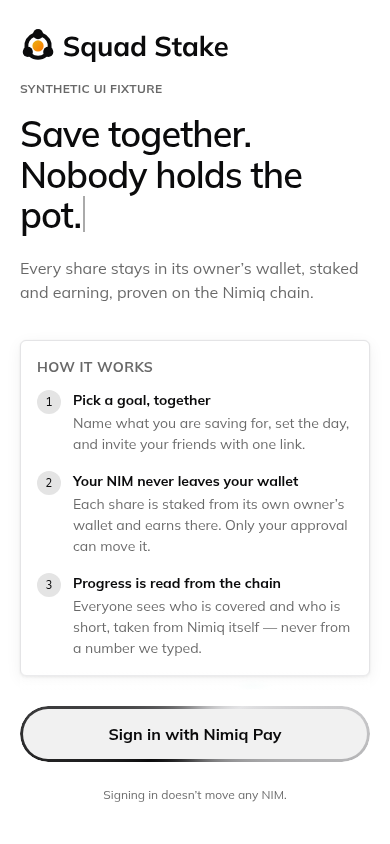
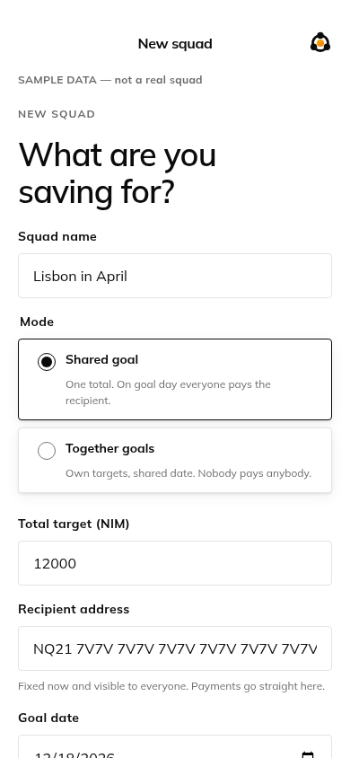
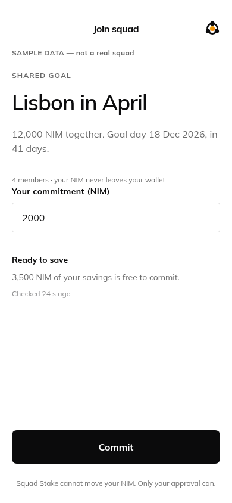
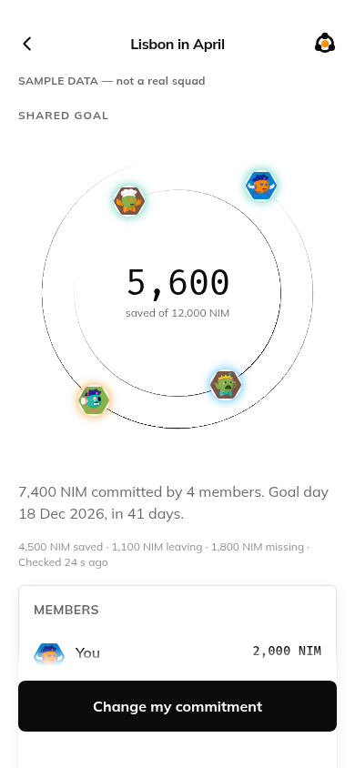
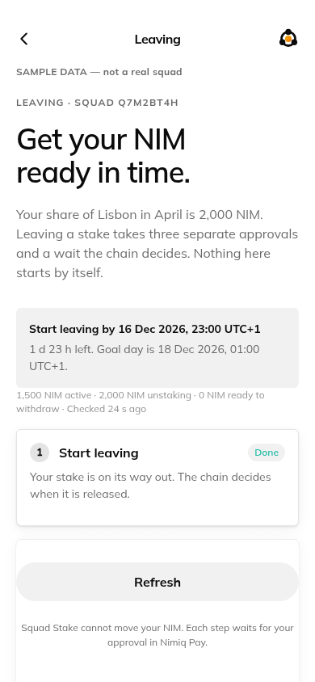
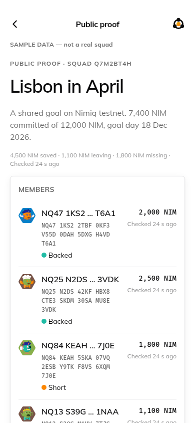

<p align="center">
  
</p>

# Squad Stake

### 👉 **Live app: <https://squad-stake.vercel.app>** · **Judges: start here → [JUDGING.md](JUDGING.md)** · **Demo video: _(link to be added before submission)_**

**Save together for anything — and nobody holds the pot. Every member's share stays staked in
their own wallet, earning, and the squad's progress is read off the Nimiq chain instead of being
typed into a database.**

A Nimiq Pay Mini App. Mini Apps Competition Cycle III, category **Save**.

---

## The problem

Five friends decide to save for a trip. One of them collects the money. Now one person carries
all the risk, nobody else can check the balance without asking, and the money sits in a current
account doing nothing until April.

Every workaround has the same shape: *somebody has to hold it.* A group jar, a shared account, a
smart contract — all of them take custody, and all of them ask the group to trust either a person
or a lock.

Squad Stake does not hold anything. Each member's share is **staked from their own wallet**, so
it never leaves their control, it earns while it waits, and **the chain is what reports
progress**. Nobody has to be trusted, because nobody has to be believed.

## How it works

1. **Create a squad.** A name, a goal day, and either one shared total (with a recipient fixed up
   front) or everyone's own target. One link invites the rest.
2. **Each member commits — and stakes in their own wallet.** The commitment is only saved once
   the chain has actually executed and finalised their staking transaction. Their NIM never moves
   anywhere but into their own stake.
3. **Everyone sees honest progress.** Every status on the squad page comes from a fresh
   `getStakerByAddress` read for that member's address, with **the age of the read printed beside
   it**. Saved, short, leaving, ready, withdrawn, paid. Nothing is stored as truth.
4. **Goal day.** The app tells each member when they have to **start leaving** so their NIM is
   liquid in time — the protocol's release wait is 12–24 hours and nothing starts by itself. Then
   three approvals get the NIM back in their wallet, and (shared-goal squads) a payment to the
   recipient, verified on-chain: recipient, amount, `sq:` marker, execution and finality.

| | | |
|---|---|---|
|  |  |  |
| **Save together. Nobody holds the pot.** | **Both modes, with quick starts** | **Commit, backed by your own stake** |
|  |  |  |
| **Every status read from the chain** | **The release wait, off the chain** | **Public proof, no session needed** |

Every screenshot above is rendered from the same components the app ships, from the labelled
sample fixtures in `packages/ui/scenes/` — never a mock-up, and never real people's data.

## How it uses Nimiq

| | |
|---|---|
| **Identity is a signature** | One `sign()` approval. The server verifies it against the official Nimiq signed-message digest and **derives the address from the public key** — `listAccounts()` is never used, and a claimed address is never trusted. That address is also the member's staker address |
| **Six staking calls, all through Nimiq Pay** | `sendNewStakerTransaction`, `sendStakeTransaction`, `sendSetActiveStakeTransaction`, `sendRetireStakeTransaction`, `sendRemoveStakeTransaction` and `sendBasicTransactionWithData` for a shared-goal payment. One provider call per tap, no automatic retries, and nothing moves without an approval |
| **Status comes from Nimiq RPC, every time** | Nine typed, strictly parsed read methods with positional parameters and a five-second timeout; staker and validator reads cached 60 s per address, and the commitment rule bypasses that cache. No balance and no status is ever stored |
| **Release timing is the protocol's own math** | `getBlockAfterReportingWindow(getElectionBlockAfter(inclusionBlock))`, and for a jailed validator the later of that and `getBlockAfterJail`. Derived from the inactivation's **inclusion** block, never from the staker's `inactiveFrom` — which on testnet was 43,167 blocks later |
| **A hash is never success** | Every hash goes into `tracked_txs` and is checked for `executionResult` **and** 60 confirmations (one batch, so the including macro block has passed). Included-but-failed is a real outcome, and this app has a real one recorded |
| **Payments verified without matching the sender** | Nimiq Pay pays from a cosigned HTLC, so the sender is not the member's address. A payment counts on recipient + value ≥ share + the `sq:<short id>` marker + execution + finality |
| **Validator choice is pool-aware** | Active, not jailed, not retired, and listed by Nimiq's own Validators API with a payout type that is not `none` — then the one with the fewest Squad Stake members, counted from the chain. Its name, fee and payout type are shown before the approval |
| **Nimiq Pay's own context** | Language from `getHostLanguage()` (en, es, de, fr, pt), fiat currency from `getHostFiat()`, and every action blocked unless `window.nimiqPay.network` matches the app's network |

## What it isn't

- **Not custody.** There is no code in this repository that can move anyone's NIM. No pot, no
  escrow, no contract holding a balance.
- **Not a lock.** A member can leave at any time, and the squad sees it immediately. That is the
  honest cost of self-custody, not a bug.
- **Not a rotating-payout circle, and not a lottery.** No chance mechanics anywhere.
- **Not a staking optimiser.** NimJar does single-user staking well; Squad Stake is a group
  product built on top of staking.
- **Not a dashboard of invented numbers.** Where a figure cannot be read, the screen shows "—"
  and says why. Sample data is labelled as sample data.

---

## Honest limitations

Repeated from `briefing/PROOF_PLAN.md`, which is the ledger this project holds itself to:

- **Proven on testnet, 2026-11-08:** a real phone in Nimiq Pay — sign in → create squad →
  *Create staker* approved → the hash tracked to executed-and-final → the squad page showing that
  member's status derived from a chain read.
- **Not proven on mainnet** at the time of writing. The mainnet switch is `docs/GO-LIVE.md`.
- **Not proven:** a complete real leaving cycle (start → release → confirm → withdraw) and a real
  shared-goal payment end to end. Both paths are covered by unit and adversarial tests against
  **recorded real testnet envelopes**, and every refusal in them has been exercised against the
  live node — but no leaving or payment transaction has been signed by this build on any network.
- **Not proven:** real usage. The app went live for judging, not before it.
- **Not built:** the Remotion demo video renders from `packages/ui`, and `apps/video` is still a
  placeholder.
- **No `direct`-pool earnings figure is possible yet:** no Nimiq validator publishes a payout
  address (0 of 21 mainnet, 0 of 13 testnet when checked on 2026-11-08), so those payouts cannot
  be told apart from any other transfer. The screen says exactly that instead of estimating.
- `docs/AUDIT.md` lists this project's own findings against itself, including the ones not yet
  fixed.

---

## Run it

Node ≥ 22.15, pnpm 10.18.3, Postgres (Neon supported).

```sh
corepack enable
pnpm install
pnpm deps:check
cp apps/web/.env.example apps/web/.env.local     # DATABASE_URL, APP_ORIGIN, NEXT_PUBLIC_NIMIQ_NETWORK
export DATABASE_URL_UNPOOLED='postgres://…'       # the migration CLI does not read .env.local
pnpm db:migrate
pnpm dev
```

`APP_ORIGIN` is the exact origin with no trailing slash, and must be HTTPS in production.
`NEXT_PUBLIC_NIMIQ_NETWORK` is `mainnet` or `testnet` and must match the network Nimiq Pay is on;
it is inlined at build time, so **redeploy** after changing it.

**Checks.** `pnpm gate` = typecheck + lint (including the `packages/ui` purity rule) + unit tests
+ adversarial tests + `next build` + guards against the production artifact + secret scan +
dependency-age check, ending with `git diff --exit-code`, so it wants a clean tree.
`pnpm check:scenes` drives the system Chromium over every fixture scene at 390, 375 and 320 px in
both themes and fails on an element crossing the frame, on horizontal scroll, or on a tap target
under 44 px. `LIVE_RPC=1 pnpm test:live` reads the live testnet node; it signs and sends nothing.

**Dev harness.** `DEV_HARNESS=1 pnpm dev` adds `/scenes` (every fixture state, both themes) and
`?as=alice|bob|carol` — reproducible Ed25519 test identities that sign in through the same
challenge/verify/session path. They are public test keys: never fund them. A test proves a
production artifact refuses all of it even if the flags are set at runtime.

**Database.** `pnpm db:reset-data` empties every data table and keeps `schema_migrations`. It
prints the tables and their row counts first, and refuses unless given both `--confirm` and the
exact host name of the database it is pointed at. It is step 2 of `docs/GO-LIVE.md`.

## Brand

The logo is an original drawing in code: a warm goal at the centre, three members on a ring that
breaks at each of them — the squad around the goal, nobody in the middle, because nobody holds the
pot. It borrows **no shape** from Nimiq (the hexagon is Nimiq's); it borrows Nimiq's colours,
which is what a mini app should look like. "Squad Stake" is outlines generated from the Mulish 700
file this repo self-hosts, so the lockup needs no font wherever there is no stylesheet.

One list of shapes in `packages/ui/brand/shapes.ts` feeds the React components (`LogoMark`,
`Logo`, `AppIcon`) and the exported files; `tests/unit/brand.test.ts` fails if the two ever differ
or if an exported file is stale. `pnpm brand:export` rewrites `apps/web/public/brand/` (SVG
lockups and marks in four tones, the app icon, PNGs at 16–1024 px and a `favicon.ico`); it needs
the system Chromium that `pnpm check:scenes` already uses, so no image library is installed. Run
`node scripts/build-wordmark.mjs` only if the Mulish file changes.

## Architecture in one paragraph

`apps/web` is Next.js (App Router, TypeScript strict) on Vercel: route handlers under
`app/api/**`, pure cores under `src/core` and `src/server/core` with the clock, the chain and the
store injected, and thin containers that load data and pass props. `packages/ui` owns every
screen and is **pure** — data, callbacks, `now` and animation time (`t`, in seconds) come in as
props, so there is no fetch, no SDK, no clock and no timer inside it, and every screen has a
fixture scene for each of its states. That is what lets the demo video render the identical
components frame by frame, and it is enforced by a lint rule. `@nimiq/core` and the database are
server-only; the Nimiq Pay SDK is loaded only in client code, only after a tap. Amounts are
integer luna everywhere and are formatted only at the UI edge. Further reading: `docs/PRD.md`
(what), `briefing/BUILD_CONTRACT.md` (frozen decisions), `docs/ARCHITECTURE.md` (how),
`briefing/FAILURE_MODES.md` (the guards), `docs/PROGRESS.md` (what actually ran), `AGENTS.md`
(the rules this build is held to).

## Deploy

Vercel (Next.js on `apps/web`) with Neon Postgres added through the Vercel Marketplace, which
provisions `DATABASE_URL` (pooled, PgBouncer in transaction mode) and `DATABASE_URL_UNPOOLED`
(direct). Exact project settings:

| Setting | Value |
|---|---|
| Framework Preset | Next.js |
| Root Directory | `apps/web` |
| Include source files outside of the Root Directory in the Build Step | **enabled** — `packages/ui`, `pnpm-workspace.yaml` and `pnpm-lock.yaml` live above it |
| Install Command | `npm_config_store_dir=/tmp/pnpm-store npm_config_cache_dir=/tmp/pnpm-cache npm_config_cache=/tmp/npm-cache pnpm install --frozen-lockfile` |
| Build Command | `pnpm build` |
| Output Directory | `.next` (the default) |
| Node.js Version | 22.x (the root `engines` field requires ≥ 22.15 and `engine-strict` is on) |

`apps/web/vercel.json` already sets the framework and both commands. The environment prefixes in
the install command exist because this repository's `.npmrc` pins pnpm's store and caches to
absolute paths inside the developer's checkout; on a build machine those paths do not exist, so
the install is redirected to a writable one. `next.config.ts` sets `outputFileTracingRoot` to the
repository root so the workspace's linked packages are traced.

Environment variables, all four needed in Production (and Preview, if used):

| Variable | Value |
|---|---|
| `DATABASE_URL` | Neon's **pooled** connection string (host ends in `-pooler`), as the Marketplace sets it, with `sslmode=require` |
| `DATABASE_URL_UNPOOLED` | Neon's **direct** connection string; used by `pnpm db:migrate` and `pnpm db:reset-data` |
| `APP_ORIGIN` | the deployment's exact origin, e.g. `https://squad-stake.vercel.app`, no trailing slash (HTTPS is enforced in production) |
| `NEXT_PUBLIC_NIMIQ_NETWORK` | `mainnet` or `testnet`, matching the network Nimiq Pay is on; inlined at build time, so redeploy after a change |

Vercel runs no migrations. Apply them from a shell with the direct endpoint:
`DATABASE_URL_UNPOOLED=… pnpm db:migrate` (idempotent, and it takes a transaction-scoped advisory
lock). Switching an existing deployment between chains is `docs/GO-LIVE.md`.

The request path uses the pooled URL with `prepare: false`, because PgBouncer's transaction mode
cannot keep a named prepared statement alive between statements, and with `ssl: 'verify-full'`,
which authenticates Neon's certificate rather than only encrypting as `sslmode=require` does; a
loopback database may still be plaintext. The commitment rule's `SELECT … FOR UPDATE` transaction
is unaffected: transaction-mode pooling pins one server connection for a whole `BEGIN … COMMIT`,
so the row locks last until the commit, and the commit path uses no session-lifetime state. The
reasoning is in `apps/web/src/server/lib/db-config.ts`; `tests/unit/db-config.test.ts` asserts it.

### Two deployments from one repository

A mainnet copy and a testnet copy are the **same commit deployed twice** — never a branch and
never a build flag: two Vercel projects, each with its own Neon branch and its own `APP_ORIGIN`.

| | mainnet copy | testnet copy |
|---|---|---|
| `NEXT_PUBLIC_NIMIQ_NETWORK` | `mainnet` | `testnet` |
| Neon | the `production` branch | a second branch, with its own pooled and direct strings |
| `APP_ORIGIN` | e.g. `https://squad-stake.vercel.app` | e.g. `https://squad-stake-testnet.vercel.app` |
| Nimiq Pay deeplink | `https://nimpay.app/miniapps/open/<that host>` | the same, with the other host |

It is safe because **every network-specific value comes from `NEXT_PUBLIC_NIMIQ_NETWORK`**, in one
place — `apps/web/src/config/network.ts`:

| Value | mainnet | testnet |
|---|---|---|
| RPC node (every chain read, and the call the proof page prints) | `https://rpc.nimiqwatch.com` | `https://rpc.testnet.nimiqwatch.com` |
| Explorer base (transaction links) | `https://nimiq.watch/#` | `https://test.nimiq.watch/#` |
| Nimiq Validators API (pool data) | `https://validators-api-main.je-cf9.workers.dev/api/v1/validators` | `https://validators-api-test.je-cf9.workers.dev/api/v1/validators` |

The host guard reads the same variable, so a testnet build opened inside a mainnet Nimiq Pay can
read but cannot act, and the other way round. `serverEnv()` defaults an unset or misspelt variable
to `testnet`, so a missing variable can never point a deployment at mainnet, and the client
guard's own default of `mainnet` then fails the comparison and blocks every action too. The proof
page prints the network it read and the exact RPC call, so a reader can tell the two copies apart
without taking the app's word for it. `tests/unit/network-config.test.ts` asserts the switch and
scans every `.ts`/`.tsx` under `apps/web` for a hardcoded endpoint outside that one file.

---

MIT licensed. Third-party notices: the self-hosted Mulish and Fira Mono files carry their OFL
licences in `packages/ui/fonts/README.md`.
